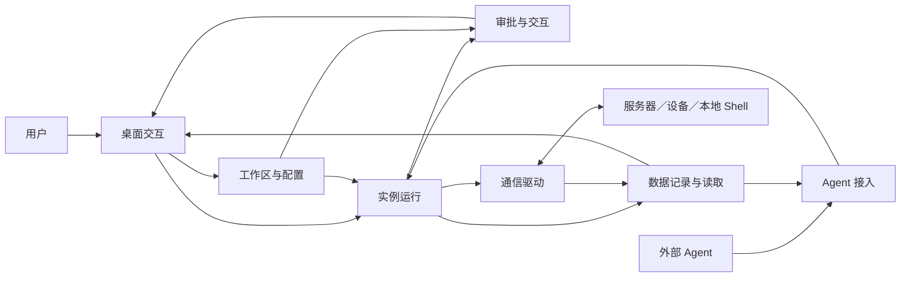

# 1. 模块架构

## 系统目标

人类通过桌面操作连接，Agent 通过工具操作同一连接实例。用户决定目标、授权范围和执行方式；系统保留可查询的操作状态与有界设备数据，明确区分“已发送”“已结束”和“结果未知”。

项目提供终端交互、基础字节调试和协同控制。不承担设备业务协议解释、波形分析、信号计算、通用自动登录编排或任意本地文件代理。

## 模块划分

| 模块 | 工作内容 | 不负责的内容 |
|---|---|---|
| 工作区与配置 | 实例保存项、工作区分组、布局、配置恢复和保存失败处理 | 实际连接、运行结果、设备数据归属 |
| 实例运行 | 运行身份、目标校验、操作调度、状态和资源生命周期 | 协议认证、命令解释、界面布局 |
| 审批与交互 | 规则组、独立实例审批、提案决策、认证等用户响应 | 执行命令、替用户开启免审批、推断设备结果 |
| 通信驱动 | 连接、认证、输入输出、协议差异与执行边界 | 工作区分组、全局授权、Agent 的默认目标选择 |
| 数据记录与读取 | 操作状态摘要、设备数据、命令结果、选区及有界查询 | 长期审计、无限历史、设备协议解码 |
| 桌面交互 | 配置表单、实例视图、终端、字节调试、审批和设置 | 充当 Agent 的数据权威来源、伪造后端完成状态 |
| Agent 接入 | 工具目录、外部名称路由、提交与结果查询 | 创建隐式实例、伪造人工来源、修改授权配置 |

这七项是职责划分。一个模块可以由前后端共同完成，也可以与其他模块位于同一软件包；不能仅为文档中的模块名称增加独立进程、调度层或存储层。

## 模块关系

下面表示业务协作关系，不表示每个请求必须顺序经过所有模块。

通信驱动内部按真实协议区分 SSH、Serial、Local、Telnet 和 Raw TCP。终端与字节调试是用户交互方式；Shell 与字节流是读取和命令解释能力。它们不构成第二套实例体系。

## 关键概念

| 概念 | 定义与关系 |
|---|---|
| 驱动 | 某种通信能力；一种驱动可以承载多个实例 |
| 保存项 | 可跨启动恢复的实例配置身份，不代表正在运行或已连接 |
| 运行实例 | 一次启动中可被路由的对象；恢复保存项会生成新的运行身份 |
| 物理连接／Shell 会话 | 当前服务器连接、串口句柄或本地 Shell；重连或重启后身份变化 |
| 操作 | 一次有来源、目标、状态和结果的提交；等待结束不代表操作结束 |
| 审批提案 | 尚未执行的操作草稿；批准绑定本次参数和目标 |
| 规则组 | 独立存在的匹配模式与规则列表；每实例最多引用一个组 |
| Bypass | 用户主动开启的实例免审批开关，不等于免认证 |
| 对话 | 一次输入与归属结果；边界是否可靠、结果是否完整必须明确 |
| 终端选区 | 用户明确选择的文本，不等于所有终端输出或已选命令块 |

运行状态、连接状态、操作状态是三个不同问题：实例可用不等于已连接，连接存在不等于设备在线，操作提交成功不等于设备执行成功。

## 业务边界

1. 人类与 Agent 共用实例和连接，不因为调用入口不同另建隐藏会话。
2. Agent 的目标来自明确实例名称或严格的唯一连接判定，不跟随当前标签页。
3. 每实例独立审批和 Bypass；规则组可以共享，实例开关不共享。
4. 后端保留有界原始数据和命令记录，前端保留显示副本；Agent 读取后端。
5. 默认在可见终端执行命令；预计长时间运行或用户明确要求后台时才选择独立后台执行。
6. 知道的状态如实返回；缺失、截断、丢弃、超时和无法确认的完成结果不能伪装成成功。

需求入口见[模块需求](02-requirements/)，公共约束见[公共需求](03-common-requirements.md)；具体数据责任见[模块交互](04-module-interactions.md)。
