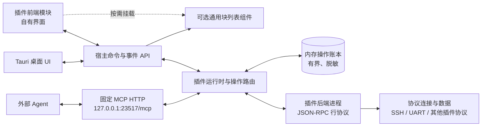
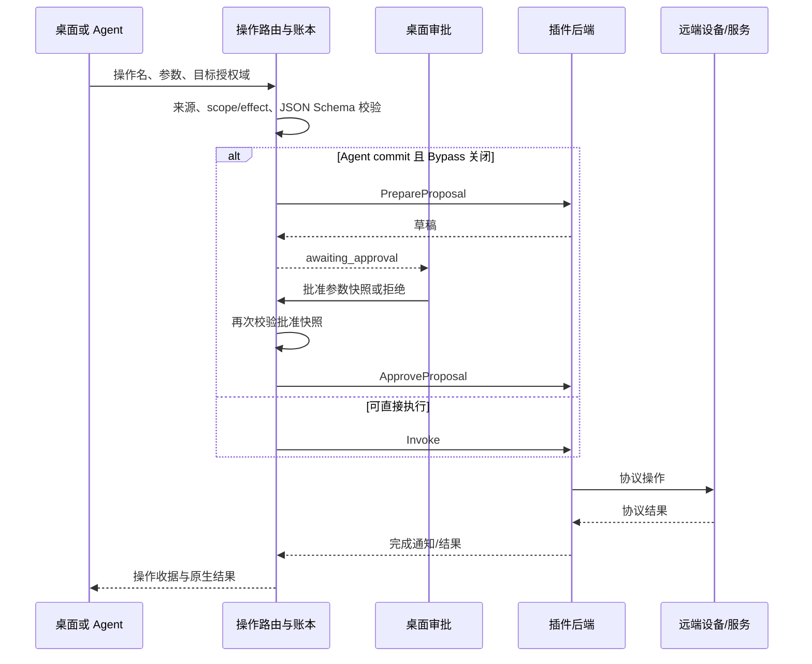

# 当前已实现架构

此图描述当前 MVP 实现，不代表尚未接通的目标能力。接口状态和已知限制见[架构与实现状态](interface-review.md)。

插件可用的 TypeScript 契约和通用 UI 位于 `packages/plugin-sdk`，不依赖桌面 React 应用。桌面自有组件按区域放在 `apps/desktop/src/components/{host,plugins,mcp,ui,terminal}`；插件只能通过 SDK 接口取得通用组件，不能导入桌面源码。

## 运行组件

桌面和 MCP 都进入同一操作路由及插件进程。MCP Tools 由插件注册；宿主按插件命名空间和操作目录决定目标。实例级调用必须带实例 ID，插件级调用由可信路由上下文绑定插件 ID。插件前端访问插件后端时使用绑定当前实例的 HostAPI。

## 操作执行与审批

等待超时只结束本次等待，不取消操作。取消请求由宿主交给插件处理：只有插件确认未提交或已停止才记为 `cancelled`；不能确认时记为 `unknown`。例如 SSH 后端尽力发送 Ctrl+C，但不把字节送达当成远端命令已停止的证明。

桌面审批在工作区底部以非模态面板展示命令和通过/否决按钮：横向铺满工作区，两侧边框接齐工作区边界，顶部保留圆角，底部贴合状态栏。面板通过滑入动画出现，不遮罩其他区域、不抢占终端焦点。用户可修改命令；焦点在面板内时 Enter 通过、Esc 否决。结构化参数以单行 JSON 编辑，插件级与实例级操作共用该呈现方式。

## 操作授权域

| scope | 目标 | 授权依据 | 例子 |
|---|---|---|---|
| `instance` | 一个插件实例 | Tauri 从实例表解析 session；MCP 要求显式 `pluginInstanceId` | SSH connect、UART 读写 |
| `plugin` | 插件本身，不绑定实例 | 宿主从 Tauri 命令或注册 Tool 名称构造 `pluginId` 授权上下文 | 插件版本、设备发现 |

调用者不能在参数中自报来源或 effect。MCP 调用总是 Agent 来源；桌面命令总是 Human 来源。操作输出需符合可选 output schema，否则状态为 `unknown`。

## 界面布局与视觉规范

桌面采用三区域流式布局：左侧插件图标栏（64px/72px）、实例列表栏（200px/240px，支持折叠恢复）以及主工作区（自适应铺满）。

- **响应式断点**：在窄窗口（< 900px，如 768px）下实例栏自动收起折叠以最大化工作区可用宽度；顶部工具栏提供可键盘操作、带无障碍名称（`aria-controls`、`aria-expanded`、`aria-label`）的恢复与折叠开关，并在面板内设有关闭触发器，避免不可恢复折叠。
- **视觉 Token**：基座在根样式 `:root` 定义一套统一语义 token（`--coterm-surface*`、`--coterm-border*`、`--coterm-text*`、`--coterm-accent*`、`--coterm-danger*`、`--coterm-focus*`、`--coterm-font-*`），Tailwind 配置将语义类直接映射到这些 CSS 变量。
- **Shadow DOM 共享与 Fallback**：插件前端（如 SSH）和通用组件（如 BlockList）通过 CSS Custom Properties 穿透 Shadow DOM 继承全局主题；所有变量均携带合理默认 fallback，确保无变量注入时仍可读。
- **现状记录**：当前默认基准为深色模式，浅色模式扩展与动态主题切换留待后续阶段，当前不在交付承诺范围内。
